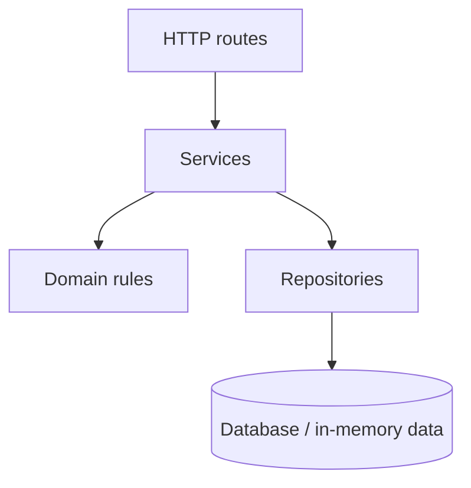
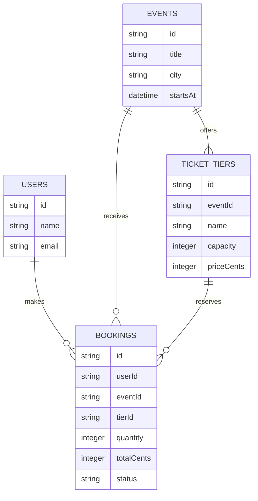
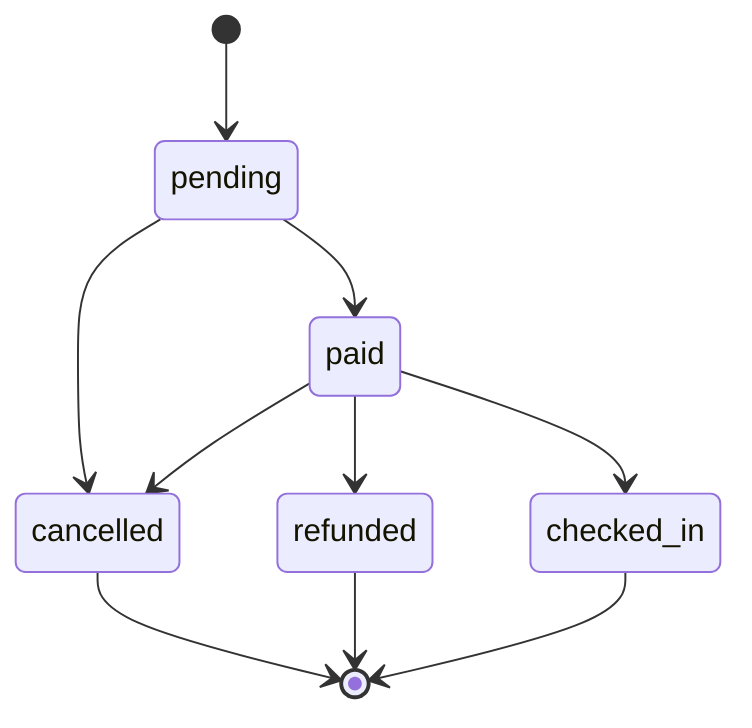

# Build 3 Architecture

## Layers

Routes may translate HTTP requests and responses, but may not implement business rules or access data directly.

Services may coordinate domain rules and repositories, but may not depend on HTTP details or make persistence decisions themselves.

Domain rules may validate and compute business outcomes, but may not perform HTTP, filesystem, or database I/O.

Repositories may read and write data, but may not decide business policy or call services and routes.

## Data Model

## Booking Life Cycle

